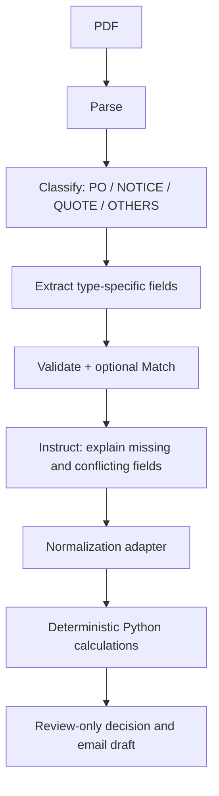

# Studio Agent Workflow V1 — design, not executed

**Why these documents:** PO proves the original order/date, DELAY_NOTICE proves changed delivery, SUPPLIER_QUOTE bounds real replacement delivery/price/capacity. Inventory and customer orders stay in trusted CSV rather than LLM memories.
**Studio outputs (normalized target keys):** `document_id,document_type,po_id,supplier_id,original_delivery,revised_delivery,items,quote,warnings`. These are our downstream schema keys, not a claim about native Studio export structure.
**Classify definitions:** PURCHASE_ORDER is buyer issued PO with original ETA; DELAY_NOTICE supplier notice about changed ETA; SUPPLIER_QUOTE offers price, capacity and date; OTHERS contains unmatched/no-quote documents.
**Extract prompt:** “Extract only visible facts. Never infer unavailable values; set null. Preserve every product line and unit. Return original and revised dates separately in ISO YYYY-MM-DD, preserving source document ID. Identify conflicting PO IDs and warn. Do not calculate shortages or hallucinate prices.”
**Instruct prompt:** “Review extraction for PO/product/date conflicts, absent dates and unsupported units. Summarize verified facts and cite document IDs. Produce draft text only; do not send. Use quantities and monetary results only when provided by deterministic Python output.”
**Fallback:** if native Validate/Match unavailable, implement strict Python adapter + schema validation. Ambiguous document or PO mismatch => needs review; no automatic submission.
**Workflow test:** C001-C004 first; compare extracted JSON vs source-checked gold; then run remaining 16 cases; record agent/version/model, predictions and failures. **Export real agent configuration JSON from Studio**. This document and our schema do not replace Studio export. Actual account access/API runs not yet done.
Official documentation: https://console.upstage.ai/ko/docs/studio/key-features ; https://console.upstage.ai/docs/agents